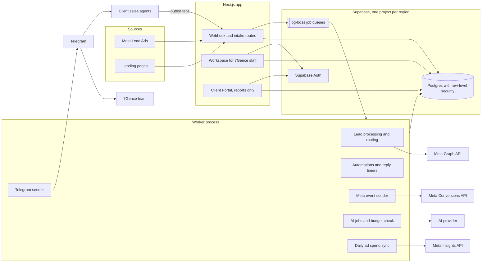

# Architecture — Qualent

**Status: approved 2026-11-01.** Build order is in [ROADMAP.md](ROADMAP.md).

Evidence labels: **[Official]** vendor docs read directly. **[Secondary]** third-party source. **[UNVERIFIED]** from general knowledge or not confirmed; check during build. **(opinion)** a judgment call. This is not legal advice; have UAE counsel review section 12.

## 1. What your answers mean for the design

| Your answer | What we build |
|---|---|
| 1c: several industries | The core has no industry-specific tables. Industries are **pipeline templates** plus **custom fields**. UAE real estate is the first template. No Property record in v1. |
| 2c: 7Gence works leads, clients see reports | Two surfaces: the **Workspace** (7Gence staff) and the **Client Portal** (reports only). White-label applies to the portal. |
| 3a, 3b: Telegram alerts to our team and client agents | Client sales agents do not log in. **Telegram is how qualified leads reach them.** Telegram chat with leads (3c, "maybe") is Later. |
| 4a, 4b: Meta forms, landing pages | Two automatic intake adapters plus manual entry and CSV, all feeding one `ingestLead()` function. |
| 4c: WhatsApp, then dropped by decision 4b | **No WhatsApp connection in v1.** Staff enter WhatsApp leads by hand. See section 6.2. |
| 5a: agents contact leads outside the CRM | The CRM **never sends messages to leads in v1**. In-CRM WhatsApp sending (5b) and SMS/email (5c) come later. |
| 6a + 6c: all stages go to Meta, each client can change it | Every stage is on by default, with a per-client override set by 7Gence staff. Meta's rules limit this; see section 7. |
| 7a–e: all five AI features | All are in v1, as suggestions only. AI never sends anything by itself. "Call summaries" means summaries of staff notes, including chat text pasted into a note, because v1 records no calls and has no WhatsApp connection. |
| 8a: cheap model plus Kimi for hard jobs | Model choice is open. See section 9. |
| 9a: English only | English screens only. No Arabic fonts or right-to-left testing in v1. CSS logical properties stay, because they cost nothing. Leads may still write in Arabic: we store it correctly and AI summarizes it in English. |
| 10a: logo, colors, name | Per-client branding in the portal. Custom domains are Later. |

### The four decisions

| # | Decision | What it means |
|---|---|---|
| 1a | **Telegram result buttons** | Each delivered lead has buttons such as Contacted, Viewing, Won, Lost. One tap updates the CRM, so the reassign rule works for client agents and Meta receives late-stage signals. |
| 2b | **Mumbai hosting, on Vercel's free plan for v1** | Supabase Mumbai plus Vercel Mumbai, with jobs run on demand. See sections 12 and 13. |
| 3 | **AI model decided later** | The backend works with no model: leads stay unscored. See section 9. |
| 4b | **No WhatsApp in v1** | Click-to-WhatsApp ads cannot be attributed automatically or optimized through the CRM in v1. See section 6.2. |

## 2. System overview



Main flow:

1. A lead arrives. The webhook stores the raw event, queues a job and replies to the sender right away.
2. The worker fetches any missing details, removes duplicates and assigns the lead.
3. Telegram alerts the assigned person. A reply timer starts.
4. AI scores the lead a moment later. The alert never waits for AI.
5. 7Gence staff qualify the lead and deliver it to the client's agent on Telegram.
6. Each stage change queues a Meta event. Reports join those stages with daily ad spend.

## 3. Tech stack

| Area | Choice | Why |
|---|---|---|
| Frontend | **Next.js 16**, React 19, TypeScript, Tailwind 4, `design/theme.css` | Same stack as the reference, except 16 instead of 15.5. Next 16.4 is `latest` and 15 is on a backport tag, so a new project should not start a major version behind (opinion). |
| UI parts | shadcn/ui, TanStack Table and Query, dnd-kit, react-hook-form, zod, Recharts, lucide-react (all MIT) | License-safe and already reviewed in `docs/research/open-source-crms.md`. |
| Database | **Supabase Postgres**, also used by the reference | Row-level security, backups and Auth in one service, and it can be self-hosted if we must move. |
| DB access | Drizzle ORM (Apache-2.0) from the server only | Real transactions. The browser never talks to the database. |
| Auth | Supabase Auth | Already in the platform. MFA required for staff. |
| Jobs | **pg-boss** (MIT) on the same Postgres | No Redis, no extra service. Delayed jobs give us "wait N minutes". |
| Hosting | **Vercel Hobby in Mumbai** (`bom1`), with jobs run on demand and no always-on worker | Your decision for v1. Limits are in section 12, and the job design is in section 13. |
| Phone numbers | libphonenumber-js (MIT) | Standard E.164 parsing. |
| Monitoring | Sentry, plus internal health page and Telegram ops alerts | See section 13. |

Not used: Redis, Kafka, microservices, a workflow engine such as Temporal, n8n (its license excludes this use), and a metadata engine for custom objects.

## 4. Multi-tenancy and data isolation

**Model:** one shared database and schema, with `tenant_id` on every row. One tenant is one client. 7Gence is a tenant too, for its own leads. There is no agency or reseller layer, because resellers are out of scope. If needed later, add `agency_id` to `tenants`.

**Isolation has four layers:**

1. **Row-level security on every tenant table**, forced even for the table owner:
   ```sql
   alter table leads enable row level security;
   alter table leads force row level security;
   create policy tenant_isolation on leads
     using (tenant_id = current_setting('app.tenant_id')::uuid)
     with check (tenant_id = current_setting('app.tenant_id')::uuid);
   ```
2. **One door to the database.** All code, including the worker, goes through `withTenant(tenantId, fn)`, which opens a transaction and runs `SET LOCAL app.tenant_id`. The application connects as `app_user`, which cannot bypass row-level security. `SET LOCAL` stays safe with Supabase's transaction pooler.
3. **Composite foreign keys**, such as `(tenant_id, lead_id)`, so a row in one tenant cannot point at another tenant's row even if there is a code bug.
4. **No direct browser access.** Supabase's auto-generated API is turned off for app tables, so a leaked public key exposes nothing.

**A CI test enforces this:**
- It lists every table with a `tenant_id` column and fails if row-level security is off.
- It reads and writes as tenant A against tenant B's data and expects nothing back.

`withTenant` only runs after the server confirms the user is a member of that tenant. A missing `app.tenant_id` raises an error, so a forgotten tenant returns no data rather than all data.

Rejected: a schema per tenant, which makes every migration N times the work. A very large or strict client can get its own regional deployment of the same code instead.

## 5. Data model

```mermaid
erDiagram
  TENANTS ||--o{ MEMBERS : has
  TENANTS ||--o{ PIPELINES : has
  PIPELINES ||--o{ STAGES : has
  TENANTS ||--o{ CONTACTS : has
  CONTACTS ||--o{ LEADS : has
  PIPELINES ||--o{ LEADS : holds
  STAGES ||--o{ LEADS : current
  MEMBERS ||--o{ LEADS : owns
  LEADS ||--o{ TOUCHES : came_from
  LEADS ||--o{ ACTIVITIES : timeline
  LEADS ||--o{ TASKS : has
  LEADS ||--o{ STAGE_HISTORY : moved
  LEADS ||--o{ CAPI_EVENTS : sends
  TENANTS ||--o{ AD_INSIGHTS_DAILY : spend
  TENANTS ||--o{ AI_USAGE : cost
```



| Table | Key columns | Notes |
|---|---|---|
| `tenants` | `name`, `region`, `timezone`, `currency`, `brand` (json), `ai_monthly_budget_usd`, `retention_days` | `region` exists from day one. |
| `profiles` | `id` (Supabase user), `name`, `is_platform_admin` | Login identity. |
| `members` | `tenant_id`, `user_id` (nullable), `role`, `record_scope`, `telegram_user_id`, `telegram_chat_id`, `weight`, `working_hours` | **A client's sales agent is a member with no login.** If clients log in later, we invite the same row. |
| `contacts` | `name`, `phone_e164`, `phone_raw`, `email`, `consent_source`, `consent_text`, `consent_at`, `opted_out_at`, `erased_at` | Unique per tenant on phone and on email, where present. |
| `leads` | `contact_id`, `pipeline_id`, `stage_id`, `owner_member_id`, `status`, `score`, `temperature`, `score_reason`, `first_response_at`, `value`, `value_currency`, `custom` (json) | One buying interest. A person can have several leads over time. |
| `touches` | `source`, `meta_leadgen_id` (unique), `page_id`, `form_id`, `ad_id`, `adset_id`, `campaign_id`, `utm_*`, `fbclid`, `fbc`, `fbp`, `pixel_event_id`, `client_ip`, `user_agent`, `occurred_at` | Real columns, not custom fields. The first touch and latest touch give first-touch and last-touch attribution. |
| `pipelines`, `stages` | `stages`: `position`, `name`, `kind` (open, qualified, won, lost), `capi_enabled`, `capi_event_name`, `sla_minutes` | Copied from a template per tenant, so later template changes never overwrite a client's edits. |
| `stage_history` | `lead_id`, `stage_id`, `entered_at`, `actor` | Powers funnel reports and Meta events. |
| `activities` | `kind` (note, call, message, stage, assignment, ai, system), `body`, `data` (json), `external_id` (unique when set), `occurred_at` | One timeline. There is no separate messages table in v1. |
| `tasks` | `lead_id`, `assignee_member_id`, `due_at`, `done_at`, `title` | |
| `custom_field_defs` | `key`, `label`, `type`, `options`, `required` | Values live in `leads.custom`, validated by the server. Filterable through a GIN index. |
| `routing_rules` | `mode`, `conditions`, `members`, `sla_minutes`, `escalate_to`, `max_reassigns` | |
| `automation_rules`, `automation_runs` | `trigger`, `conditions`, `steps` (json); run: `step_index`, `status` | Unique on `(rule_id, lead_id)` so a lead enrolls only once per rule. |
| `connections` | `kind` (page, ad_account, dataset, pixel), `external_id`, `secret_encrypted`, `status` | Encrypted with AES-256-GCM (Node `crypto`). |
| `capi_events` | `event_id` (unique), `event_name`, `shape`, `status`, `attempts`, `last_error`, `sent_at` | Delivery log and health page data. Holds hashed data only. |
| `ad_insights_daily` | `date`, `campaign_id`, `adset_id`, `ad_id`, names, `spend`, `currency`, `impressions`, `clicks`, `leads` | Unique per date and ad. |
| `ai_usage` | `task`, `model`, `input_tokens`, `output_tokens`, `cost_usd` | Budget ledger. |
| `audit_log` | `actor`, `action`, `table_name`, `row_id`, `before`, `after`, `at` | Append-only. |
| `webhook_inbox` | `source`, `external_id` (unique), `payload`, `received_at`, `processed_at`, `error` | Not tenant-scoped, because the tenant is only known after parsing. Deleted after 30 days. |
| `ai_models` | `provider`, `base_url`, `model`, `price_in`, `price_out`, `no_training`, `reasoning_effort`, and a task-to-model map | Global config, editable without code. |

Rules that apply everywhere:
- Times are `timestamptz` in UTC, shown in the tenant's time zone.
- Money is `numeric` plus a currency code.
- Phones are E.164. A number we cannot parse is kept in `phone_raw` and flagged, never dropped.

## 6. Lead intake, routing and automation

### 6.1 Intake

All adapters write to `webhook_inbox` first and then reply. Processing happens in a job, so a slow Meta API or a crash loses nothing. Target: from lead received to Telegram alert in under 10 seconds (proposal; Meta's own webhook can take "a few minutes" [Official, per `crm-architecture.md` 3.1]).

| Source | How it arrives | Details |
|---|---|---|
| **Meta Lead Ads** | Page `leadgen` webhook, verified with `X-Hub-Signature-256` | Fetch the lead by `leadgen_id`. The webhook has no campaign ID [Official], so look up ad to campaign and cache it. **Every 15 minutes, poll recent leads per form as a safety net** for missed webhooks. |
| **Landing pages** | `POST /api/intake/:publicKey`, with a small JS snippet or plain HTML form | Captures UTM, `fbclid`, `_fbc`, `_fbp`, consent text, and a Pixel `event_id` created in the browser. Protected by rate limit, honeypot and allowed origins. |
| **Manual, CSV** | Staff screen, with a source field and a campaign picker | Same `ingestLead()`. This is how WhatsApp leads enter in v1. |

`ingestLead()` handles all of them:
1. Normalize the phone.
2. Find the contact by phone, then email. If the phone and email match two different contacts, phone wins and the lead is flagged for review.
3. If the contact has an open lead, add a touch. Otherwise create a new lead.
4. Route the lead, alert, and queue AI.

It is safe to run twice, because `meta_leadgen_id` and `external_id` are unique.

### 6.2 WhatsApp: not in v1 (your decision 4b)

Client numbers keep working exactly as they do today, with none of the coexistence restrictions.

**What this costs:**
- **Click-to-WhatsApp ads cannot be tied to the CRM automatically.** Meta puts its click ID (`ctwa_clid`) on the first inbound message, so without a WhatsApp connection we never see it. It cannot be created by hand [Secondary].
- **So those leads send no Meta events.** A `wa.me` link with a campaign code in the pre-filled text helps staff pick the right campaign by hand, but that is a manual tag, not Meta attribution (my inference; no source documents it as a method).
- **Cost-per-qualified-lead reports only count campaigns we can trace.** Manually tagged leads count in the report but are labeled as manual.
- **Reply time** is measured from logged calls, notes and Telegram "Contacted" taps, not from WhatsApp itself.

**Practical rule for v1:** if a client's campaign needs Meta to optimize on lead quality, run it on Meta forms or a landing page.

**Adding it later** needs one more intake adapter, one more Meta event shape and a `ctwa_clid` column. Nothing in v1 blocks this. The coexistence findings are kept in [whatsapp-coexistence.md](research/whatsapp-coexistence.md), including the unconfirmed UAE eligibility and possible Meta partner requirement.

### 6.3 Routing and the reply timer

Modes: round robin, weighted, and by rule (for example by campaign or custom field). Only working hours count, in the tenant's time zone.

When a lead is assigned, we schedule a delayed job for `sla_minutes` later. When it fires:
- If `first_response_at` is set, nothing happens.
- If not, the lead moves to the next person and the manager is alerted. After `max_reassigns`, it goes to the manager and stops, so leads never loop forever.

`first_response_at` is set by a call or note logged by staff, or a Telegram "Contacted" tap.

### 6.4 Automation engine

Rules, not a visual builder, in v1:

- **Trigger:** lead created, stage changed, score changed, task overdue, no activity for N days.
- **Conditions:** field checks.
- **Steps:** wait, create task, send Telegram alert, move stage, assign, tag.
- **Exit:** stops on a chosen stage or on a reply.

Each wait is a delayed pg-boss job. On waking, it re-reads the lead and re-checks the conditions, so a stale rule does nothing. A lead enrolls only when it newly matches (Close's approach), which prevents mass re-enrollment. Rule chains stop at a depth of 3 to prevent loops. No "send message to lead" step exists in v1.

Note: the step list and JSON format are enough for a visual builder (React Flow, MIT) later, with no engine rewrite.

## 7. Meta Conversions API

One sender with **two payload shapes**, picked by the lead's first touch. Leads entered by hand or from CSV send no events unless they carry a real Meta `lead_id` or click ID.

| | Meta form leads | Landing page leads |
|---|---|---|
| Mechanism | Conversion Leads [Official] | Pixel plus CAPI [Official] |
| `action_source` | `system_generated` | `website` |
| Match keys | `lead_id`, then hashed email and phone | `fbc`, `fbp`, IP, user agent, hashed email and phone |
| Event names | Your own stage names | Standard or custom events |
| All stages? | **Yes, and Meta requires every stage including the first** | Yes, sent as custom events (opinion: useful mainly for Qualified and Won) |
| Extra fields | `custom_data.event_source=crm`, `lead_event_source=Qualent` | `event_source_url` |

**Stage mapping.** Each `stages` row has `capi_enabled` (on by default) and `capi_event_name`. Staff can change these per client (your 6c). If someone turns off a stage on a client using Conversion Leads, the screen warns that Meta needs every stage.

**Hashing.** SHA-256 after normalizing: email trimmed and lowercased; phone digits only with country code and no `+`; names lowercased. `lead_id`, `fbc`, `fbp`, IP and user agent are **not** hashed. `fbc` and `fbp` keep their exact casing [Official]. A unit test with known input and output values covers this, because a wrong hash fails silently and just lowers match rates.

**Dedup with the Pixel.** The landing page creates `event_id` in the browser, fires the Pixel with it, and posts it with the form. The server sends the same `event_id` and `event_name`. Meta dedupes within 48 hours [Official]. Later stages have no Pixel event, so their ID is `{lead_id}:{stage_id}`. This also means **re-entering a stage never sends twice**.

**Retries.** A stage change writes a `capi_events` row and queues the job in the same database transaction. Failures retry with backoff (1 minute, up to 6 hours). **Anything older than 7 days is marked `expired` and not sent**, because Meta rejects it [Official]. Permanent errors such as an invalid token alert the ops channel.

**Test events.** Each dataset connection can hold a `test_event_code`, used only on non-production deployments, plus a "Send test event" button for checking setup in Events Manager. Production code refuses to send a test code.

**Health check per client:**
- Conversion Leads eligibility: at least 200 leads a month, 1–40% conversion on the target stage, and the target stage within 28 days [Official].
- Events sent, failed and expired, and days since the last late-stage event.

Below 200 leads a month, events still flow but Meta may not optimize on them. The reports must say so honestly. We expect 2–4 weeks of learning [Official].

**Restricted categories.** Because you are serving several industries (1c): Meta may block lower-funnel events for health and financial businesses, and sources disagree on how far this applies to lead events **[Secondary, conflicting]**. Check the dataset's category in Events Manager when onboarding a client. We do not try to work around it.

**Access.** Meta Business Verification and App Review are needed for `leads_retrieval` and `ads_read` [UNVERIFIED]. **Start this before coding; it is a schedule risk outside our control.** The Graph API version is pinned in one config value (v26.0 at the time of research).

## 8. Telegram

**One shared bot in v1**, with a neutral name. A per-client bot is Later. Telegram only appears to the sales team, so it does not need client branding yet.

| Item | Design |
|---|---|
| Linking a person | Staff click "Link Telegram" on a member and get `t.me/<bot>?start=<one-time code>` (64 characters max [Official], 15-minute expiry). The bot stores `telegram_user_id` and `telegram_chat_id`. |
| Team alerts | To a group per tenant: new lead, hot lead, no reply yet, Meta errors. Masked phone plus a link to the lead. |
| Lead delivery | A private message to the client's agent: name, phone, what they asked, AI summary, and buttons. Agents need the phone number to call. |
| Buttons | Inline callback buttons, which do not add chat messages [Official]. The server checks the tapper is linked to this tenant and owns this lead, then writes the stage change, including its Meta event. |
| Rate limits | About 1 message per second per chat, 20 per minute per group, 30 per second overall [Official]. A dedicated queue enforces these and honors `429 retry_after`. Busy groups get a digest. |
| Inbound security | Webhook secret-token header, and privacy mode stays on in groups [Official]. |
| Failures | Retried. A permanently failed delivery shows on the lead and alerts staff, so a lead is never silently lost. The reference's "best effort, swallow errors" approach is not safe here because a lead depends on it. |
| Telegram chat with leads (3c) | **Later.** A lead must open the bot first [UNVERIFIED], so it would need a "Chat on Telegram" link in ads. Decide after real demand. `activities` can already hold it, so nothing needs building now. |

Lead data sent to Telegram leaves our hosting and is held by Telegram, so list Telegram as a sub-processor, and keep group alerts masked.

## 9. AI layer

**Provider interface.** One function, modeled on the reference's `lib/ai.ts`:

```ts
ai.run({ tenantId, task: "score_lead", input, schema }) // → { data, usage, costUsd }
```

Ollama, Kimi, DeepSeek, OpenRouter and Gemini all offer OpenAI-format endpoints ([Official] for Ollama, Kimi and DeepSeek; Gemini [UNVERIFIED]), so **one adapter plus an `ai_models` config row** covers them. Swapping a model is a config change. A provider with a different format gets a second adapter then, not now.

**Models: not decided yet (your decision).** With no `ai_models` row, leads flow normally and stay unscored. Candidates:

| Model | Price per 1M tokens (in/out) | Notes |
|---|---|---|
| Gemma 4 through Ollama (Apache 2.0 [Secondary]) | See "Where Gemma would run" | The direction you leaned towards |
| `kimi-k3.1-pro`, `reasoning_effort: low` | ~$2 / $10 [UNVERIFIED, one source]; K3 is $3 / $15 [Secondary] | Ad numbers only, because of its privacy terms |
| `gemini-3.1-flash-lite` | $0.25 / $1.50; batch $0.125 / $0.75 [Official] | Paid tier says no product training |
| `deepseek-flash` | $0.30 / $1.20 peak, half off-peak [Official] | Not for lead data until its privacy terms are checked |

**Where Gemma would run.** The model is free, but it needs a machine, and Vercel cannot host it. Token counts below are my estimate of 2,000 in and 300 out per call.

| Where | Cost | Speed | Lead data | Use |
|---|---|---|---|---|
| **Our Mac, local Ollama** | Free | About 1–7 tokens a second on CPU for similar machines [Secondary]; a Mac may be faster | Stays on the machine | **Building and testing only.** Not reliable enough for production, and client data should not sit on a laptop |
| **Ollama Cloud, `gemma4:cloud`** | About $0.40 per 1,000 leads, using a reported $0.14 / $0.40 per 1M for `gemma4:31b` [UNVERIFIED]. No monthly fee on pay-as-you-go [Official] | Hosted; 3 requests at once, then queued [Official] | Leaves our hosting, and is probably processed in the US [Secondary]. "Never logged or trained on" [Official] | **Production default.** No server to run |
| Own CPU server, Mumbai | About $155 a month for 4 vCPU and 16 GB (half of `m7i.2xlarge`'s $310; estimate from [Secondary]) | About 45–300 seconds per scoring call at 1–7 tokens a second | Stays on our server | If a contract forbids outside AI. Slow but workable for scoring, which runs in the background; poor for reply drafts |
| Own GPU server, Mumbai | About $423 a month [Secondary] | Fast | Stays on our server | If volume or speed needs it |

All of these use the same adapter with a different `base_url`, so switching is a config change. Before real lead data goes to Ollama Cloud, we would read its terms, add it to the sub-processor list, and have counsel cover the US transfer. It stays `no_training = false` until then.

**Gemma is unproven for this job.** No source covers its Arabic quality or JSON reliability, so the test set below decides.

Ollama setup notes:
- A local server has no login [Official], so any self-hosted server sits behind an HTTPS proxy that checks a secret token. Vercel has no cheap private link to it.
- Set the context length with `OLLAMA_CONTEXT_LENGTH` [Official]. Ollama reportedly defaults to 4,096 tokens without warning [Secondary].
- `json_schema` is not confirmed on Ollama's OpenAI endpoint; JSON mode is [Official]. We validate with zod either way and retry once.

Before launch, we run a small test set per task, including Arabic messages. The same test set is used whenever a model changes.

**Kimi's privacy terms (important):** the Kimi Open Platform privacy policy lists "training and refining" its machine-learning models among its uses of user content, with servers in Singapore [Official]. So:

- **Kimi receives aggregated ad numbers only** (spend, leads, cost per stage per campaign). No lead data, ever, unless Moonshot gives written no-training terms. Its one v1 job needs nothing more.
- **Lead data goes only to `no_training` models.** The router enforces this per task.

**Personal data before every lead-related call:** names, phones and emails are replaced by placeholders such as `[NAME]` and restored afterwards. Limit: regex and known-field replacement can miss a name inside free text, so the no-training rule is still required.

**AI features:**

| Task | When | Output |
|---|---|---|
| Lead score | New lead, new note (debounced) | 0–100, hot/warm/cold, reason |
| Summary | New notes, including pasted chat text | Short timeline entry |
| Next step | After score or summary | One suggested action, optionally a task |
| Reply draft | Staff asks | Text with a copy button (and a `wa.me` link). **Never auto-sent.** |
| Ad analysis | Weekly per client | Which ads bring qualified leads, not just cheap ones. Staff review it before it reaches a client. |

**Cost limits per tenant:** before each call, compare this month's `ai_usage` total with `ai_monthly_budget_usd`. At 80%, warn staff on Telegram. At 100%, stop and show "AI budget reached" on the lead. Leads keep flowing without scores. There is no fake fallback score: unscored leads say so, as in the reference.

**Where AI runs:** in the worker, on its own `ai` queue with limited concurrency, so slow AI can never delay lead alerts. Outputs are validated with zod. Lead messages are untrusted text and could contain prompt injection, so the model gets **no tools** and can only return schema-checked fields.

## 10. Auth, roles, permissions, audit

Login uses Supabase Auth with email and password or magic link. **MFA is required for staff.**

| Role | Who | Access |
|---|---|---|
| `platform_admin` | 7Gence leadership | All tenants, settings, AI models |
| `manager` | 7Gence staff | Assigned tenants: everything, including connections |
| `agent` | 7Gence staff | Assigned tenants: leads, with `record_scope` all or assigned-only |
| `client_viewer` | Client | Portal only: their reports and aggregated numbers. No individual lead records in v1. |
| `field_agent` | Client sales agent | **No login.** Telegram only, and only leads delivered to them. |

Permissions follow GoHighLevel's three axes: which tenants, which actions, and which records. Role permissions are a constant map in code; custom roles are Later.

**Audit log.** A database trigger on key tables records who changed what, including changes made by the worker, and the app role has no update or delete rights on it. Exports and data-erasure actions are logged too. Retention: 2 years (proposal).

**Other security rules:**
- Secrets are encrypted at rest. The key lives in the environment only.
- All webhooks verify signatures.
- Logs never contain phone numbers, emails or message text.
- Brand logos are PNG or WebP only in v1; this avoids sanitizing SVG uploads.
- Dependencies are checked against a license allowlist in CI.

## 11. White-label

Per `docs/design/DESIGN_SYSTEM.md` section 9: a client sets a brand color, logo and name. The server computes a contrast-checked color set when saved (one pure function plus a sweep test), stores it on the tenant, and the portal prints it as CSS variables. Reports appear under the client's brand; the Workspace stays 7Gence-branded.

Limit: the portal URL is ours in v1 (for example `portal.<product>.com/<client>`). Custom domains are Later. The login page uses the client's branding when reached through its URL.

## 12. Regions and compliance

### Hosting: Mumbai on free plans, for v1 (your decisions)

**Setup:** Supabase Mumbai (`ap-south-1`) [Official] plus Vercel Hobby in Mumbai (`bom1`) [Official].

**Free plan limits, and what they force [Official]:**
- **Vercel Hobby is non-commercial only.** Move to Pro ($20 a seat a month) before the first paying client, or accept the risk of the account being paused.
- **No always-on worker.** A Hobby daemon gets 420 GB-hours a month, so even 1 GB stops after about 17 days. Hobby cron runs once a day. So jobs run on demand; see section 13.
- **4 hours of Active CPU, 360 GB-hours of memory, 1 million invocations a month.** Going over means waiting up to 30 days, so usage needs watching.
- **Supabase free:** 500 MB per project, and projects pause after 7 days of low activity. No point-in-time recovery.

**Check when creating the projects [UNVERIFIED]:** Mumbai on Supabase's free plan, whether scheduled jobs count as activity, and the database round trip.

**Why Mumbai:** the only speed figures found are old or vendor-supplied, but they agree it is much closer. Dubai to Mumbai about 27 ms versus Dubai to Frankfurt about 92–131 ms [Secondary].

**Why not the other hosts:**

| Host | Result |
|---|---|
| Railway | No India region: California, Virginia, Amsterdam, Singapore only [Official] |
| Fly.io | Mumbai is on its deprecated-region list and missing from its current docs [Official] |
| Google Cloud Run | Mature and has Mumbai, but more setup. A later option for an always-on worker. |
| Vercel Pro with Daemons | Daemons are in public beta, and Pro costs money. The likely next step when the first client pays. |
| AWS App Runner | Closed to new customers since 2026-04-30 [Official] |
| DigitalOcean | Bangalore, a different city from the database |
| UAE on Azure | Data stays in the UAE, but far more operations work and cost |

UAE context: Supabase has no Middle East region [Official], and Cloud Run lists no UAE region [Official]. AWS's UAE region was physically damaged in March 2026 [Secondary; current status unconfirmed].

**Trigger to add a UAE deployment:** a client's contract demands it, or final PDPL rules require it. Because every row has `tenant_id`, one tenant can be exported and moved. Next.js and the worker both run outside Vercel, and Supabase can be self-hosted.

**India law:** hosting here puts UAE personal data in India. India's DPDP Act has an outsourcing exemption in Section 17(1)(d), but commentators tie it to foreign contracts with Indian entities, so it may not fit a foreign vendor's hosting. One source says it starts 2027-05-13 [Secondary]. **Ask counsel to cover this along with PDPL transfers.**

### UAE PDPL (now)

**Status [Secondary, sources conflict]:** Federal Decree-Law 45 of 2021 is in force, but most recent commentary says the Executive Regulations are still unissued, so the grace period (6 months after issue, extendable by 6) has arguably not started. As of February 2026, no adequate-country list or standard contract clauses existed. Some sites claim a January 2027 deadline, with no official source found. **Ask UAE counsel.** Clients in DIFC or ADGM fall under separate free-zone laws [UNVERIFIED].

We build the following now, because they cannot be added to past data later:
- **Consent record per contact:** source, exact text and time. Landing page forms include consent text, and Meta forms link the client's privacy policy.
- **Roles:** the client is the data controller and 7Gence the processor, so we need a data processing agreement template and a sub-processor list (Supabase, Vercel, Ollama, Meta, Telegram, Sentry). Moonshot AI is not listed because it receives no personal data.
- **Rights:** export one contact's data, and **erase** one contact (personal fields removed, reports keep anonymous counts).
- **Retention:** `tenants.retention_days`, with a nightly job.
- **Breach readiness:** the audit log plus a written response procedure.
- **Minimum data:** the personal data stripping in section 9. If staff paste a chat into a note, it may hold other people's details, so the screen warns them to paste only what the lead wrote.

### US (later, designed for now)

A US launch means a **second deployment of the same code** (Supabase Virginia + Vercel `iad1`) with its own database and login URL. There is no cross-region data and no new code path for routing.

| Area | Already in v1 | Added for US launch |
|---|---|---|
| Consent | Consent fields, `opted_out_at` | TCPA: written consent before marketing calls or texts, quiet hours by recipient time, revocation handling, and DNC checks [UNVERIFIED; get US counsel]. A single `canContact()` check before any send. It is not needed yet because the CRM sends nothing to leads. |
| Privacy | Export, erase, retention | CCPA/CPRA and other state laws; Meta's `data_processing_options` on CAPI [UNVERIFIED] |
| Format | Time zones, currencies, E.164, `Intl` formatting | State and time zone from area code |

Meta spend reports in the ad account's time zone and currency. Onboarding checks these match the tenant and warns if not, since currency conversion is out of v1.

## 13. Jobs, scaling, monitoring, backups

**How jobs run on the free plan.** There is no always-on worker:
1. A webhook saves the event, queues a job, replies, and then runs the fast queues right away using `after()`. This is what keeps alerts quick.
2. Every minute, Supabase's scheduler checks inside Postgres whether a job is due, and calls `/api/cron/tick` only if so. Delayed jobs such as reply timers therefore run up to about a minute late.
3. Every 15 minutes it calls regardless, for the heartbeat and periodic work.

Because the check happens in Postgres, an idle system costs almost no Vercel usage. `npm run worker` runs the same code in a loop, for local development or a future always-on host. See [ADR-0005](adr/0005-jobs-pg-boss-and-inbox.md).

**Queues (pg-boss), in priority order:** `intake`, `routing`, `telegram`, `capi`, `automation`, `meta` (poll every 15 minutes, spend every 6 hours), `ai`, `maintenance`. Failed jobs retry with backoff and then go to a dead-letter queue.

Jobs are added inside the same database transaction as the data change, so we never get a stage change without its Meta event.

**Scaling path (add only when measured):**
1. Add `web` or `worker` instances. Both are stateless.
2. Larger Postgres plan, and indexes led by `tenant_id`.
3. Rollup tables if a report takes over 1 second.
4. A read replica for reports.
5. Move queues to BullMQ with Redis if pg-boss becomes the bottleneck. **Ceiling:** pg-boss adds load on the main database. All app code uses Supabase's transaction pooler [UNVERIFIED with pg-boss; test early].

**Monitoring:**
- Sentry for errors, without personal data.
- External uptime checks on web and webhook routes. Each scheduled tick writes a heartbeat row, and `/api/health` fails if it is over 20 minutes old.
- Internal health page: webhook-to-alert time, queue depth, dead letters, Meta events failed or expired, Telegram failures, AI spend, and token expiry per connection.
- Critical alerts go to a 7Gence ops Telegram group.

**Backups:**
- **On free plans there is no point-in-time recovery and backups are unconfirmed, so a nightly dump matters more until we upgrade.** The target is Supabase point-in-time recovery, plus a nightly encrypted `pg_dump` to separate object storage in another Indian city (AWS Hyderabad, `ap-south-2` [UNVERIFIED]), under its own account. That gives a different city and the same country, because March 2026 showed one region is not enough.
- Targets (proposal): at most 5 minutes of data lost, restored within 4 hours.
- A restore drill every quarter. A backup that has never been restored does not count.

**Environments:** local, staging (with Meta test events only) and production, each with its own Supabase project. Supabase's free plan allows two. Migrations run through a separate database role.

## 14. Reuse versus build

| Item | Source | License | Use |
|---|---|---|---|
| Kanban, CSV import, contact and task UI patterns | Atomic CRM | MIT | Copy selectively, add tenancy. Keep the notice in `THIRD_PARTY_NOTICES`. |
| UI libraries, Drizzle, pg-boss, libphonenumber-js | See section 3 | MIT / Apache-2.0 | Dependencies |
| Automation trigger ideas | Krayin | MIT | Ideas, code allowed |
| Custom field and workflow ideas | Twenty | AGPL plus Enterprise | **Ideas only.** Never copy code. |
| SLA ideas, field layouts | Frappe CRM | AGPL | **Ideas only** |
| Agency structure, roles, attribution ideas | GoHighLevel, HubSpot, Close | Proprietary | Ideas from public docs |
| Design tokens | `design/theme.css`, `design/tokens.json` | Ours, from the reference | Direct use |
| AI adapter and Telegram patterns | Reference `lib/ai.ts`, `lib/telegram.ts` | The owner's own project | Rewritten for this design |

**We build:** tenancy, intake, routing with reply timers, the automation runner, the Meta event sender, spend joins and reports, Telegram delivery, the AI router and budgets.

## 15. Risks

| # | Risk | Plan |
|---|---|---|
| 1 | Meta App Review or Business Verification takes weeks or is refused | Start now. Use 7Gence's own Business Manager assets for the pilot. |
| 2 | Clients rely on Click-to-WhatsApp ads, which v1 cannot attribute (section 6.2) | Check each client's ad mix at onboarding. Use Meta forms or landing pages where quality optimization matters. Reconsider WhatsApp if most clients need it. |
| 3 | Clients ignore Telegram buttons, so late-stage data is thin | Measure per client on the health page. Staff follow up. |
| 4 | Low-volume clients never reach 200 leads a month | Health check explains this honestly. Reports still work. |
| 5 | PDPL rules or a contract require UAE hosting, or counsel objects to India | Tenant export plus a UAE deployment or a move, per section 12. Get counsel's view before signing the first client. |
| 6 | Free plan limits: Vercel's non-commercial terms, or a usage limit pausing the app for up to 30 days | Upgrade before the first paying client, and watch usage. |
| 7 | AI prices or models change again, as Kimi's just did | Config-only swap, test set, price table. |
| 8 | The chosen model scores poorly, especially on Arabic | The test set decides before we build on it. Swap through config. |

## 16. Decision records

Each major choice has a short record in [docs/adr/](adr/).
